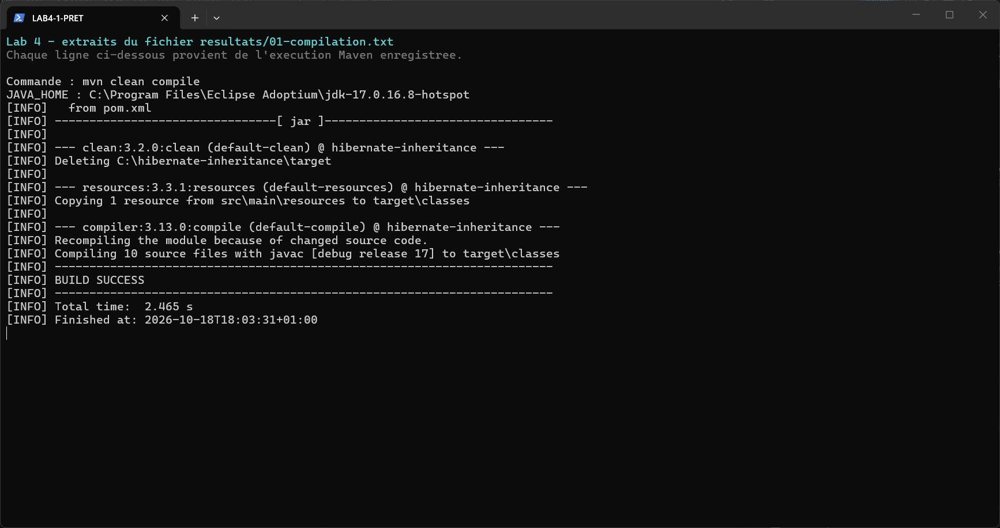
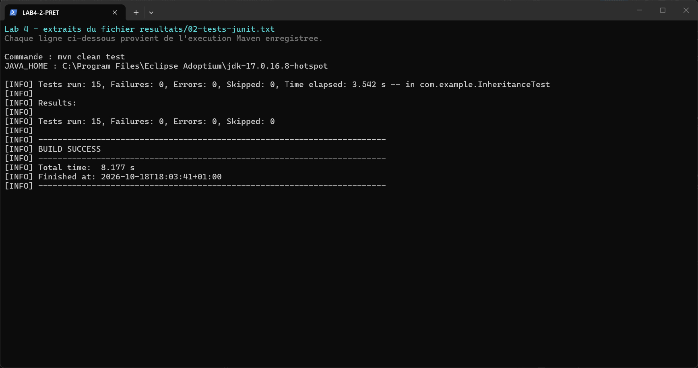
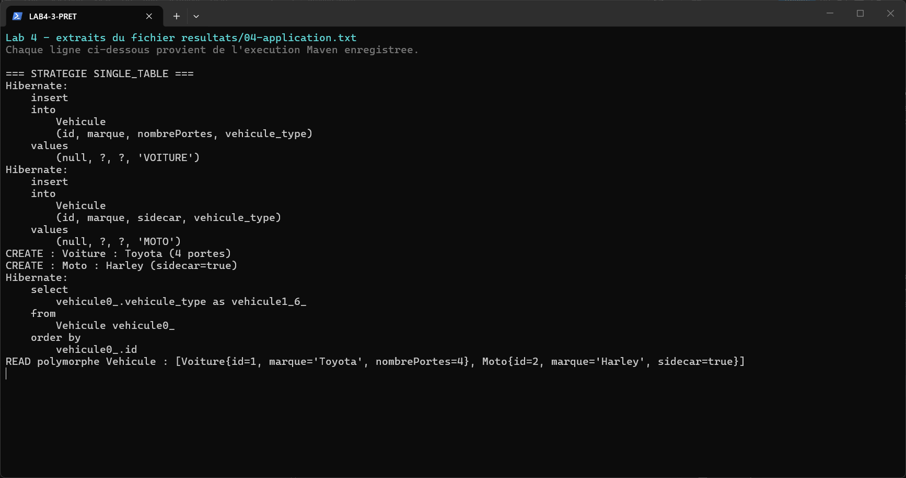
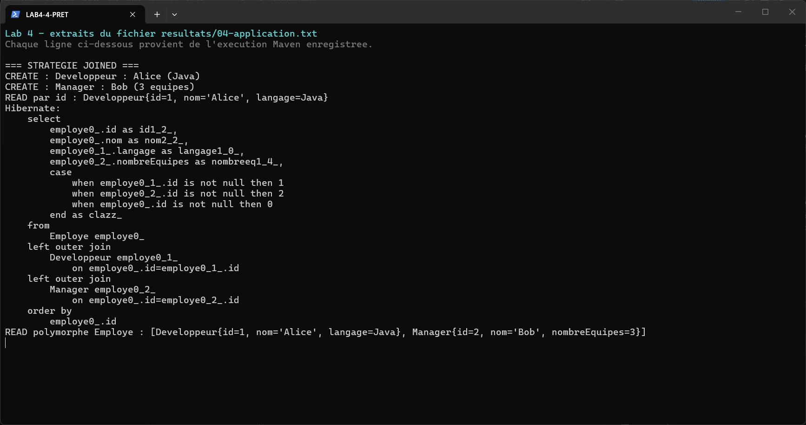
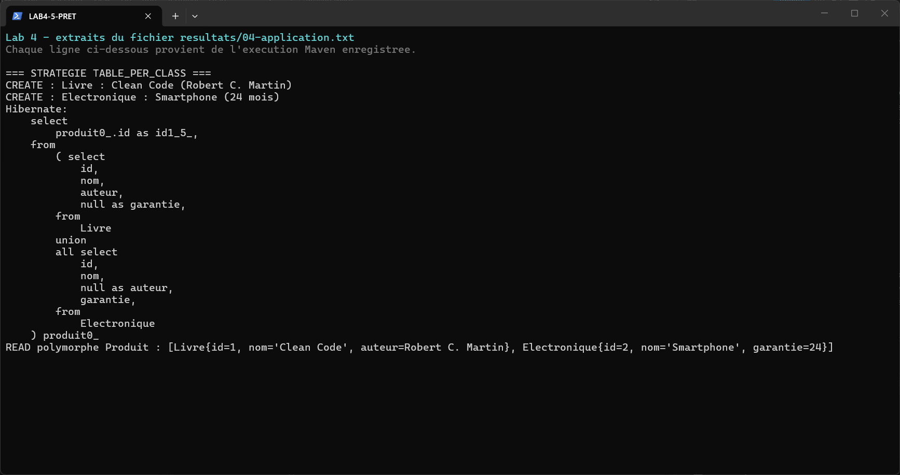
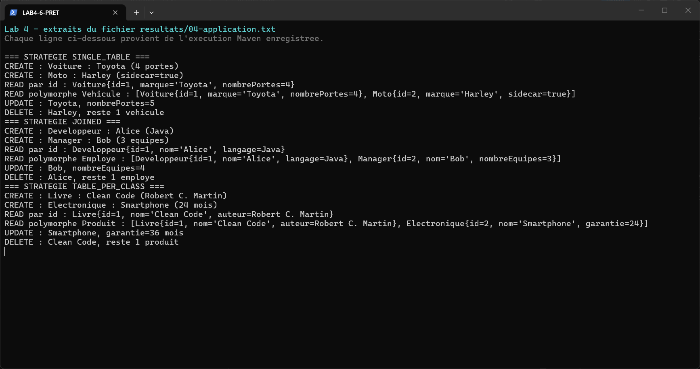
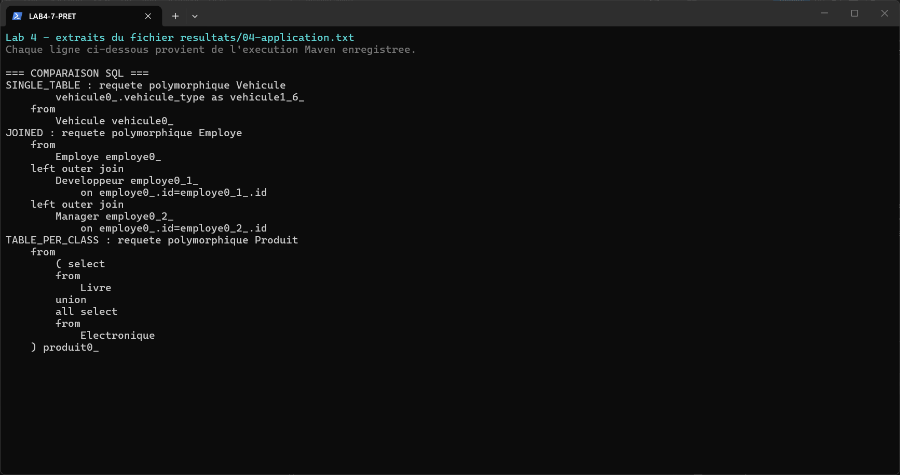
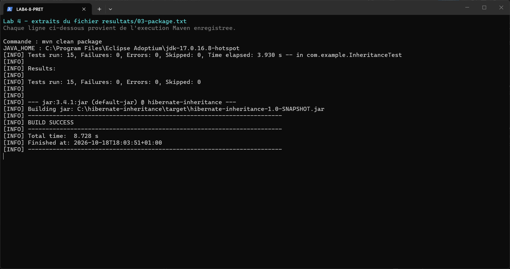

# Lab 4 – Héritage JPA avec Hibernate

## Objectif

Découvrir comment JPA enregistre une hiérarchie de classes avec trois stratégies d'héritage et comparer les tables et requêtes SQL produites par Hibernate.

## Technologies utilisées

Java 17, Maven, JPA 2.2, Hibernate 5.4.30.Final, H2 1.4.200 et JUnit 4.13.2.

## Travail réalisé

- **SINGLE_TABLE** : `Vehicule`, `Voiture` et `Moto` partagent une table avec la colonne `vehicule_type`.
- **JOINED** : `Employe`, `Developpeur` et `Manager` sont répartis dans trois tables liées.
- **TABLE_PER_CLASS** : `Livre` et `Electronique` ont chacun leur table, avec les champs hérités de `Produit`.

L'application montre la création, la lecture par identifiant et polymorphe, la modification et la suppression pour chaque stratégie. Les 15 tests utilisent chacun une base H2 isolée.

## Exécution

Avec un JDK 17 dans `JAVA_HOME`, depuis `C:\hibernate-inheritance` :

```powershell
mvn clean compile
mvn clean test
mvn clean package
mvn exec:java "-Dexec.mainClass=com.example.App"
```

## Résultats

| Étape | Résultat |
| --- | --- |
| Compilation | BUILD SUCCESS |
| Tests JUnit | 15 réussis, 0 échec, 0 erreur |
| App.java | Trois stratégies et opérations CRUD exécutées, BUILD SUCCESS |
| Packaging | JAR créé, BUILD SUCCESS |

Les sorties complètes sont conservées dans [resultats](resultats/). Les captures ci-dessous sont de vrais screenshots du terminal PowerShell affichant des extraits exacts de ces sorties.

## Comparaison

| Stratégie | Tables | Lecture polymorphe |
| --- | --- | --- |
| SINGLE_TABLE | Une table `Vehicule`, avec discriminant | Lecture dans une seule table |
| JOINED | `Employe`, `Developpeur`, `Manager`, avec clés étrangères | Jointures SQL |
| TABLE_PER_CLASS | Tables `Livre` et `Electronique`, avec colonnes héritées | Requête SQL avec `UNION ALL` |

## Captures d'écran

Compilation Maven :  


Tests JUnit :  


Une table pour les véhicules :  


Tables liées pour les employés :  


Tables séparées pour les produits :  


Création, lecture, modification et suppression :  


Comparaison des requêtes SQL :  


Packaging et création du JAR :  


## Conclusion

J'ai appris à utiliser les trois stratégies d'héritage de JPA avec Hibernate. Les tests et les requêtes SQL m'ont permis de voir comment chaque stratégie organise les tables et les lectures polymorphes.

